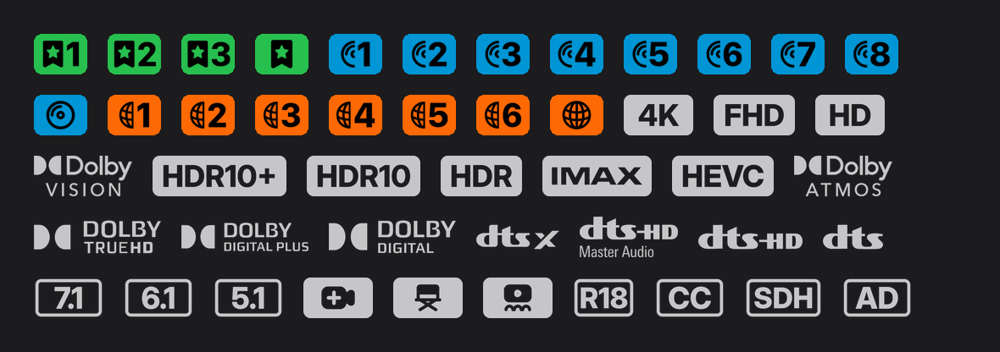

# Fusion badges

Grey media badges with regex filters for Fusion. 47 filters: release type tiers (Remux, Blu-ray, WEB), resolution, Dolby Vision and HDR, IMAX, HEVC, audio formats, channels, editions (Extended, Director's Cut, Theatrical), subtitles, rating and audio description.



## Import

Import this file's raw link in Fusion:

```
https://raw.githubusercontent.com/MohammadSall/gookoo-badges/main/fusion-badges.json
```

## Files

- `fusion-badges.json` holds the filters. Each one has a case-insensitive `pattern` matched against the release name and an `imageURL` pointing into `badges/`.
- `badges/` holds the PNG images: transparent, grey (#C6C6C8), 160 px tall. Fusion shows every image at the same height, so logos carry their own padding to match the size of the 4K and Dolby Vision badges.

## Matching

The patterns follow [Vidhin05/Releases-Regex](https://github.com/Vidhin05/Releases-Regex). Audio, Dolby Vision, resolution and channel badges use the same tag rules as the AIOStreams parser that repo builds on. Each audio badge also skips the formats Vidhin ranks above it, so a file shows one codec badge. IMAX and AD use Vidhin's own patterns.

Release type tiers use the patterns, icons and colours from [nobnobz's fusion-tags-ume](https://github.com/nobnobz/Omni-Template-Bot-Bid-Raiser/blob/main/Other/fusion-tags-ume.json). HDR shows only the best format: Dolby Vision, then HDR10+, HDR10, HDR.

## Shelves

Separate from the badges. `shelves/` holds home-row exports for the media hub, in the Fusion widgets format (`exportType: fusionWidgets`, one `collection.row` per shelf), the same format as [fusion-starter-kit](https://github.com/itsrenoria/fusion-starter-kit).

| Shelf | Collections | Raw link |
|---|---|---|
| All three shelves | 50 | `https://raw.githubusercontent.com/MohammadSall/gookoo-badges/main/shelves/all-shelves.json` |
| Collections | 25 | `https://raw.githubusercontent.com/MohammadSall/gookoo-badges/main/shelves/collections.json` |
| Animations | 10 | `https://raw.githubusercontent.com/MohammadSall/gookoo-badges/main/shelves/animations.json` |
| Studios | 15 | `https://raw.githubusercontent.com/MohammadSall/gookoo-badges/main/shelves/studios.json` |

Each collection keeps its poster, ID and list. Trakt lists use `traktList`; MDBList lists use `mdbList` with the list's ID, name and owner.
